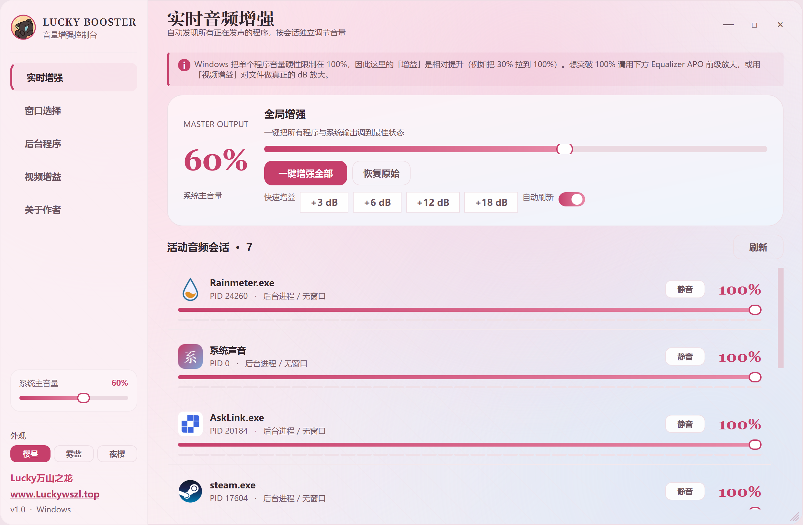
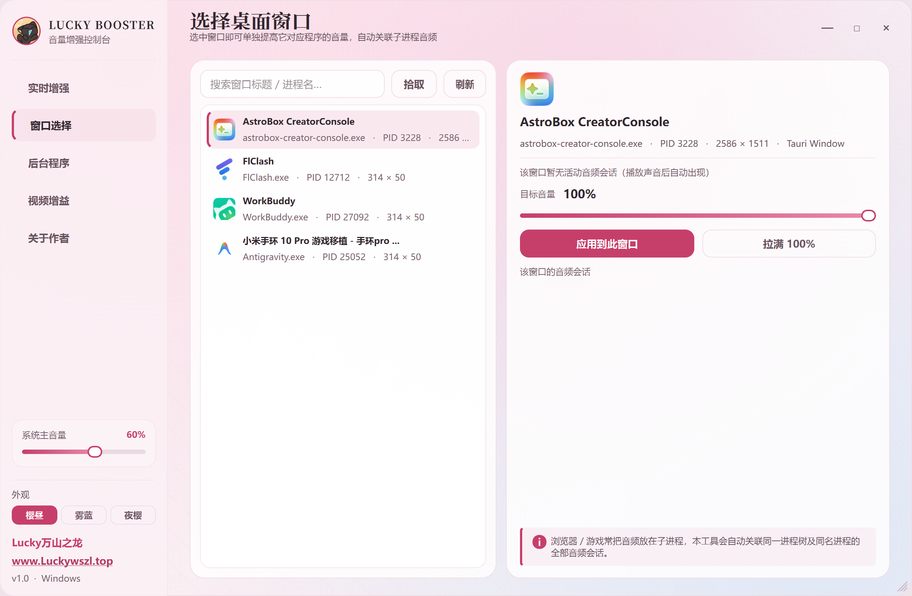
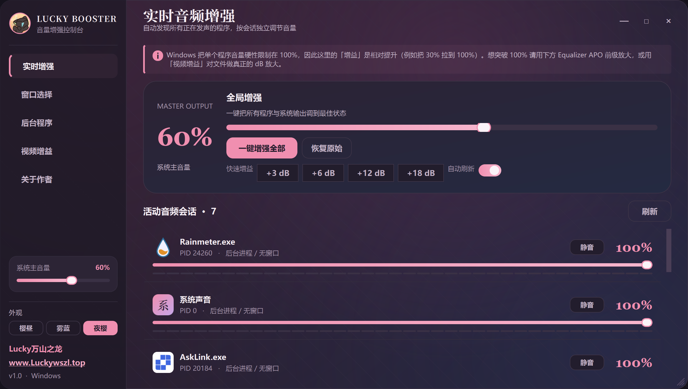

# Lucky Volume Booster

一款 Windows 桌面音频增强控制台。监控所有正在发声的程序并按会话独立调节音量，支持按窗口定向增强、后台程序增强，以及对视频/音频文件做真正的 dB 增益导出（可远超 100%）。

界面提供三套主题（樱昼 / 雾蓝 / 夜樱），带柔光氛围背景、衬线大字排版与启动动画。

**作者：Lucky万山之龙** · [www.Luckywszl.top](https://www.Luckywszl.top)

| 启动动画 | 主界面 |
|---|---|
|  |  |

| 窗口选择 | 夜樱主题（深色） |
|---|---|
|  |  |

## 功能

### 1. 实时音频增强
- 每 800ms 轮询 WASAPI，自动发现所有正在发声的程序（图标 / 进程名 / PID / 实时电平条 / 音量 / 静音）
- 单个会话滑块调节、静音开关；全局一键 +3 / +6 / +12 / +18 dB 相对增益、一键拉满、恢复原始音量
- 系统主音量双向同步（侧栏滑块与主界面滑块即时联动）

### 2. 按窗口定向增强
- 枚举全部可见桌面窗口，支持搜索过滤与「拾取前台窗口」
- 自动关联同进程树 / 同名进程的音频会话（Chrome、游戏等音频放在子进程的场景也能匹配）
- 窗口消失 / 重建后选中状态与过滤条件自动保持

### 3. 后台程序增强
- 单独列出没有可见窗口但正在发声的进程（音乐播放器、通讯软件、游戏服务、系统声音等）

### 4. 视频音量增益（真 · 超过 100%）
- 拖拽或选择文件 → 后台线程分析平均 / 峰值电平（不阻塞界面）
- 手动 0–24 dB 或自动归一化到 −1 dB，限幅器防削波
- 视频流直接拷贝不重编码、画质无损；进度条基于 ffmpeg `out_time` 精确显示，可中途取消

### 5. Equalizer APO 超频增益（一键安装，无需另行下载）
- 程序内置 Equalizer APO 1.4.2 官方安装包（SHA-256 与 SourceForge 发布页一致），「超频增益」卡片里一键静默安装，只需在 UAC 窗口点一次“是”
- 自动区分三种状态：未安装 → 一键安装；已装但没设备挂上滤镜 → 打开官方设备选择器；就绪 → 直接调 Preamp
- 只写 config.txt 且自动备份，不改注册表；安装后需重启一次电脑让驱动挂上滤波器

## 一个诚实的技术说明

Windows（WASAPI）把单个程序的音量硬性限制在 0–100%，任何用户态软件都无法仅凭 API 把某个会话推到 200%。本工具的做法是三层真实可行的方案，而不是假装有一个 200% 的滑块：

1. 会话级 / 系统级拉满与相对增益（免安装，听感提升最直接）
2. ffmpeg 文件级真 +dB 放大（导出后在任何设备生效）
3. Equalizer APO 驱动层 Preamp（全局真超 100%）

## 运行环境

- Windows 10 / 11
- Python 3.11+（源码运行时）
- 无需预装 ffmpeg（自动使用 `imageio-ffmpeg` 附带的 ffmpeg，也可将 `ffmpeg.exe` 放到 `assets/` 目录）

## 源码运行

```bash
pip install -r requirements.txt
python main.py
```

## 打包为单文件 exe

```bash
python build.py
# 产物：dist/LuckyVolumeBooster.exe（约 123 MB，含 ffmpeg，无需 Python 环境）
```

## 自检与开发工具

```bash
python selftest.py          # 音频核心 + 视频增益端到端自检
python ui_smoke.py          # 界面回归：对比度 / 进度解析 / 搜索保持 / 三档自适应 / 主题切换
python capture_preview.py   # 渲染各页面预览图到 assets/preview/
python main.py --selfcheck  # 打包后验证（frozen 环境自检）
```

## 目录结构

```
VolumeBooster/
├── main.py               # 程序入口（含 --selfcheck）
├── build.py              # PyInstaller 打包脚本（含 ICO 图标生成）
├── core/
│   ├── audio_core.py     # WASAPI 会话枚举 / 音量 / 静音 / 电平 / 主音量
│   ├── window_core.py    # 桌面窗口枚举与窗口→音频会话匹配
│   ├── video_core.py     # ffmpeg 探测 / 增益命令构建 / 进度解析
│   ├── apo_install.py    # 内置 Equalizer APO 静默安装 / 设备启用检测 / UAC 提权
│   └── eq_apo.py         # Equalizer APO 检测与 Preamp 配置写入
├── ui/
│   ├── theme.py          # 三套主题（设计令牌 + 动态 QSS，WCAG 对比度自检）
│   ├── widgets.py        # 自绘控件（电平表 / 开关 / 流式布局 / 头像等）
│   ├── splash.py         # 启动动画
│   └── main_window.py    # 主窗口与五个页面
└── assets/
    ├── avatar.jpg        # 作者头像（启动动画与侧栏 LOGO）
    └── icon.ico          # 程序图标
```

## 许可证

本项目以 [MIT License](LICENSE) 开源。`assets/avatar.jpg`（作者头像）版权归 [Lucky万山之龙](https://www.Luckywszl.top) 所有，仅供本项目展示使用，未经许可请勿用于其他用途。

### 第三方组件

| 组件 | 用途 | 许可证 |
|---|---|---|
| [Equalizer APO 1.4.2](https://sourceforge.net/projects/equalizerapo/) | 驱动层 Preamp（`assets/EqualizerAPO-x64-1.4.2.exe`，未修改的官方安装包） | GPL-2.0，源码见其项目主页 |
| ffmpeg（`imageio-ffmpeg` 附带） | 文件级 dB 增益 | LGPL-2.1 / GPL（按其构建配置） |

详见 [THIRD_PARTY_NOTICES.md](THIRD_PARTY_NOTICES.md)。
